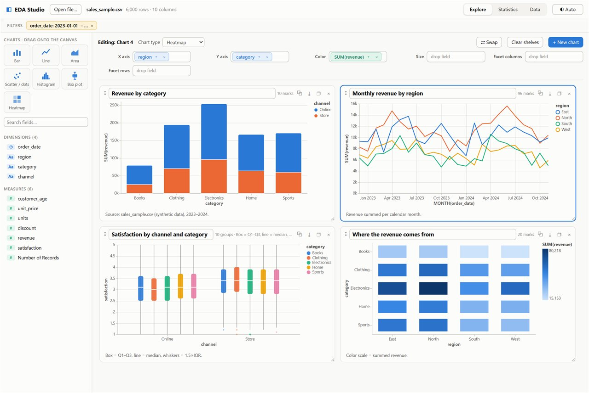
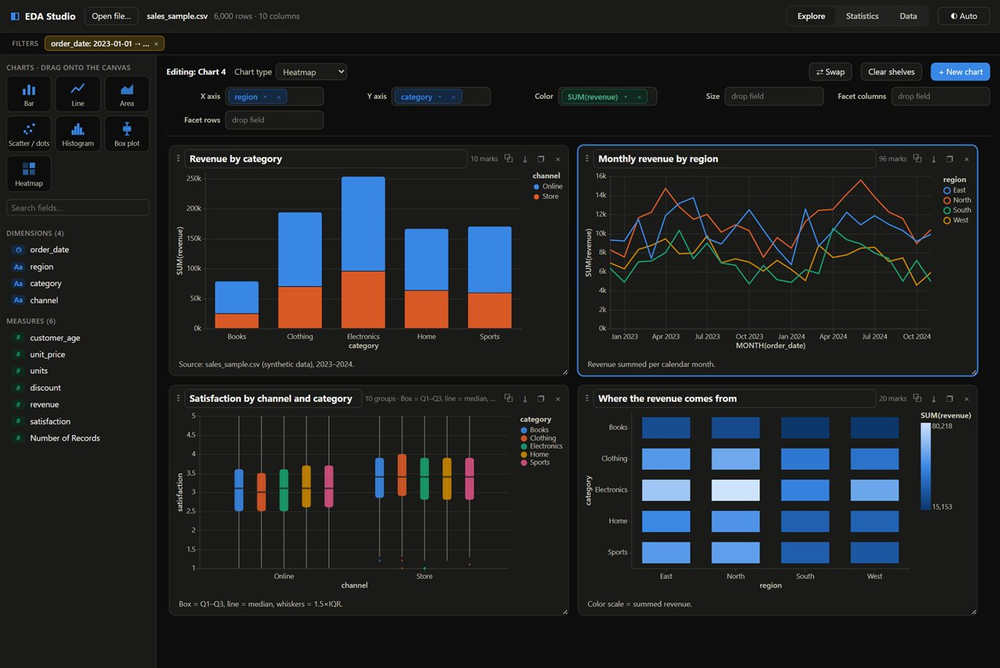
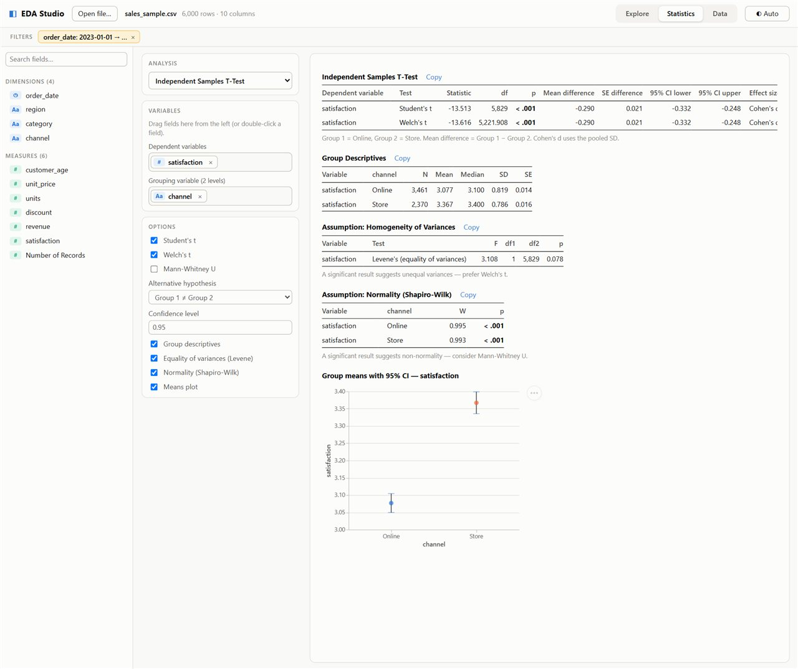
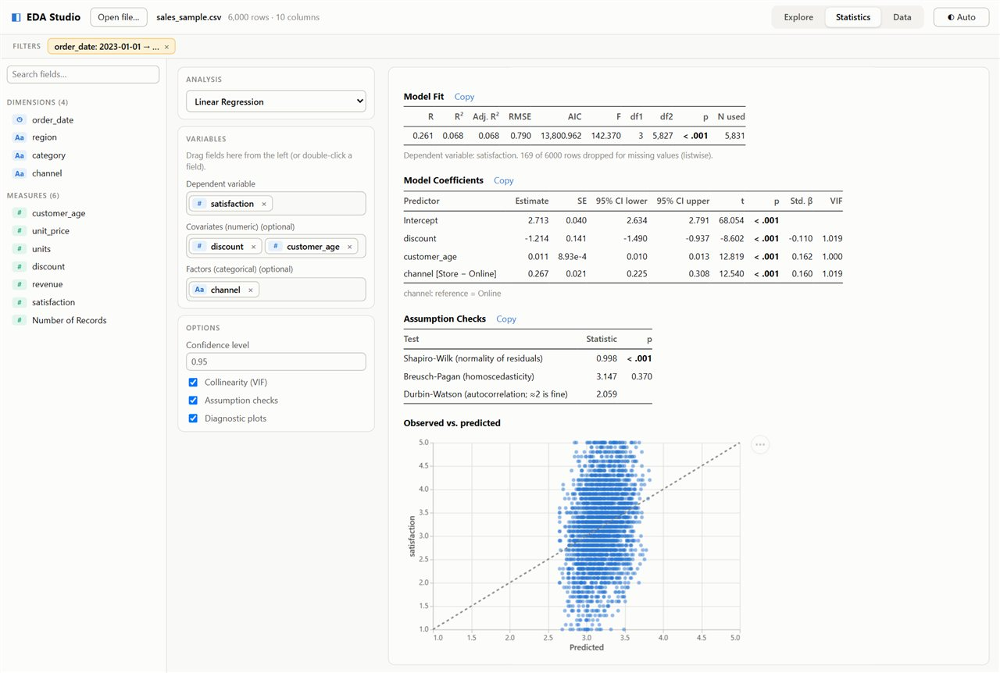

EDA Studio is a tool I built for getting to know a dataset quickly. You drag fields onto a canvas to build charts, the way you would in Tableau, and then run a statistical test on the same data without leaving the window, the way you would in Jamovi. I built it with AI assistance (Claude Code).

## Why I built it

In a notebook, the loop of load, plot, tweak and plot again is slow when you just want to understand a dataset. In EDA Studio nothing is charted automatically. You decide what goes on each axis, and the numbers are computed in a database engine, so a few million rows still feel fast.

## What it does

**Explore**
- A canvas of charts: bar, line, area, scatter, histogram, box plot and heatmap
- Shelves for the X and Y axes, color, size and facets, and a click on a field changes its aggregation, date part or bin size
- Global filters that apply to every chart, a title and footnote on each chart, and export to PNG
- Light and dark themes

**Statistics**
- Descriptive statistics, t-tests (Student, Welch, Mann-Whitney, Wilcoxon), one-way ANOVA with post hoc tests, correlation matrices and linear regression
- Assumption checks and diagnostic plots
- APA-style tables that copy straight into Excel

**Data**
- CSV, JSON, Parquet and Excel files, including Hebrew CSVs in Windows-1255
- A profile of every column: type, missing values, range and spread

## How it is built

The app runs locally, and your data never leaves your machine. The backend is Python with FastAPI and DuckDB, and the charts are drawn with Vega-Lite. The statistics are checked against `scipy` and `statsmodels`, and there is a test suite behind them. It is packaged as a portable folder that needs no installer.

The code is on [GitHub](https://github.com/EladOzCohen/EDA_Factory).
