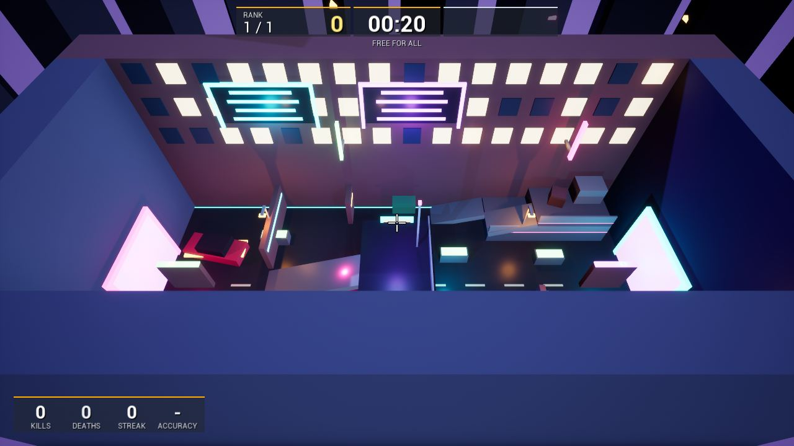
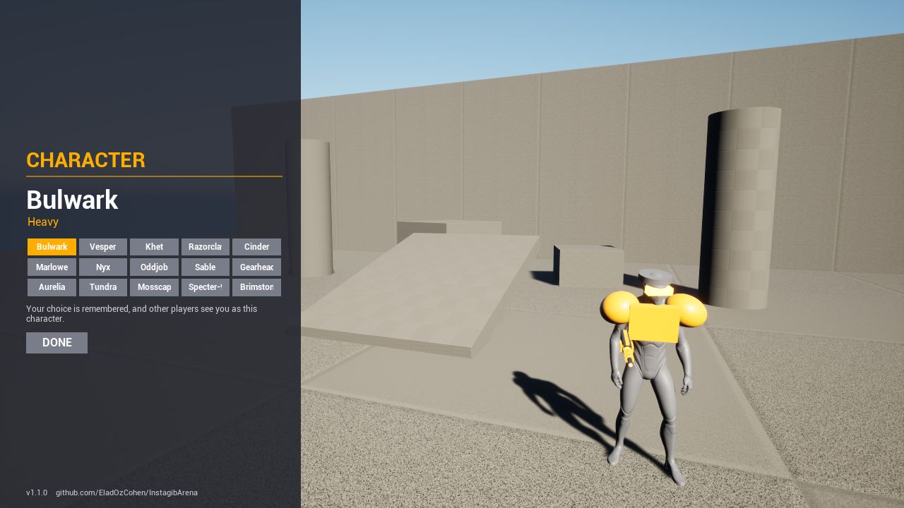
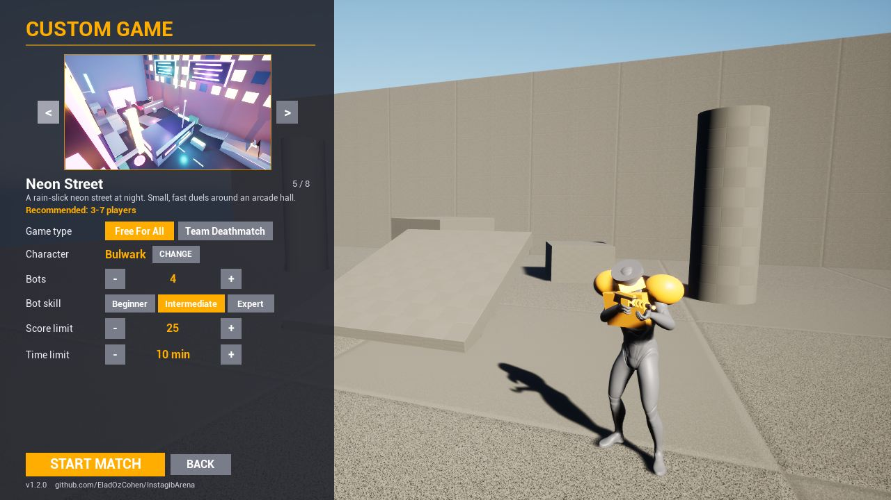

Instagib Arena is a fast first-person arena shooter for Windows, in the spirit of the instagib mode of classic arena shooters: **one weapon, one hit, one kill**. You can play alone against bots or online with friends.

It is a side project that I build in Unreal Engine 5 with AI assistance (Claude Code), and it is free and open source.

## What is in the game

- **14 maps**, from a rooftop skyline and a lava forge to space arenas, with jump pads that launch you to the high ground
- **Fast movement:** double jump, dodge, wall dodge and crouch
- **Game modes:** free for all, team deathmatch and capture the flag
- **A campaign** of 20 matches in 5 chapters, with a squad to recruit and stars to earn
- **Bots** at seven skill levels, from very forgiving to professional
- **37 characters** in five factions, picked in a menu with a live 3D preview
- **Online multiplayer** with friends: one player hosts, the others join with an address
- Full menus, rebindable keys and volume settings

## Try it

The installer is about 739 MB, runs on Windows 10 or 11, and does not need Unreal Engine or an account. Windows may show a "Windows protected your PC" notice, because the installer is not code-signed. The whole game is open source, so the code is there to read.

Download it from the [releases page](https://github.com/EladOzCohen/InstagibArena/releases/latest), or see the code on [GitHub](https://github.com/EladOzCohen/InstagibArena).
